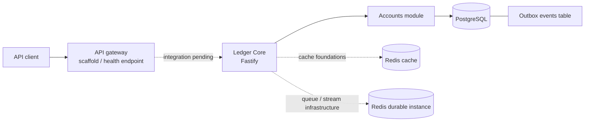

# Payment Ledger

> **Status: Work in progress.** This is an engineering project exploring the correctness and operational design of a multi-tenant payment ledger. It is not a completed payment product and is not production-ready.

The project focuses on the database and service boundaries behind financial workflows: tenant isolation, account lifecycle rules, immutable accounting records, idempotency, concurrency behaviour, and query performance.

The core idea is to make important invariants explicit and enforce them as close to the data as possible.

## Engineering focus

- **Multi-tenancy:** tenant identifiers are carried through account, transaction, ledger-entry, and idempotency data.
- **Ledger integrity:** database constraints and triggers protect account identity, ledger-entry immutability, and transaction state transitions.
- **Idempotency foundations:** transaction idempotency is scoped by tenant; idempotency records use a tenant/key primary key.
- **Account lifecycle:** accounts have explicit states; closing an account is guarded by its net balance.
- **Concurrency:** account-balance reads coalesce concurrent in-flight requests within one process; the test suite includes a dedicated concurrency stage.
- **Query design:** migrations include a covering index for ledger-entry balance reads, and a test stage is dedicated to `EXPLAIN ANALYZE`.
- **Operational boundaries:** local infrastructure separates an ephemeral cache from a Redis instance configured for durable queue/stream workloads.

## Current implementation

The repository is a pnpm/Turborepo monorepo.

| Component | Current scope |
|---|---|
| `apps/ledger-core` | Fastify service containing the account module, database integration, health/readiness checks, and lifecycle handling |
| `apps/api-gateway` | Gateway scaffold; currently exposes a health endpoint and is not yet wired to the ledger-core routes |
| PostgreSQL migrations | Tenant/account/transaction/ledger foundations, UUIDv7 identifiers, an outbox-event table, lifecycle and immutability rules |
| Account API | Create, bulk-create, bootstrap system accounts, list, lookup, read balance, and change account status |
| Test suite | Unit, integration, concurrency, load/benchmark, and query-plan test files |
| Docker Compose | PostgreSQL, a cache Redis instance, and a separate durable Redis instance |

### Service and data boundaries



The diagram deliberately distinguishes the gateway scaffold from the account service that currently contains the domain routes. The outbox table is present in the schema; a complete publisher/consumer workflow remains future work.

## Database design notes

The migrations are the most substantive part of this project.

- Tenant-scoped identifiers and indexes support tenant-aware access paths.
- UUIDv7 is used for time-oriented identifiers in the schema.
- Idempotency keys are scoped to a tenant rather than globally.
- Database triggers reject updates/deletes to ledger entries and enforce transaction lifecycle rules.
- Account identity fields are immutable; a closed account cannot be reopened.
- Account closure checks that the net ledger balance is zero.
- Ledger-entry insertion checks parent transaction state, tenant consistency, account state, and currency consistency.
- The ledger-entry index includes `entry_type` and `amount` to support covering balance queries where PostgreSQL can use an index-only scan.

These are implementation details in the current migrations; they are not evidence of a completed, externally deployed payment system.

## Local development

### Prerequisites

- Node.js
- pnpm (the root package declares pnpm 10.34.1)
- Docker and Docker Compose

### Start infrastructure

The root Compose file defines PostgreSQL and two Redis instances with different persistence and eviction policies.

```bash
cp .env.example .env
docker compose up -d
docker compose ps
```

The checked-in `.env.example` values are local placeholders. Replace them for your local environment and never reuse development credentials in a deployed environment.

### Install dependencies

```bash
pnpm install
```

### Run ledger-core

Configure the environment described in `apps/ledger-core/.env.example`, then run:

```bash
pnpm --filter ledger-core dev
```

Account routes are registered under `/v1/accounts`. The service also exposes liveness and database-readiness endpoints.

### Build and type-check

```bash
pnpm --filter ledger-core build
pnpm --filter ledger-core typecheck
```

## Test strategy

The ledger-core package contains a staged account test suite:

| Stage | Focus | Command |
|---|---|---|
| 1 | Unit tests | `pnpm --filter ledger-core test:stage1` |
| 2 | Integration tests | `pnpm --filter ledger-core test:stage2` |
| 3 | Concurrency tests | `pnpm --filter ledger-core test:stage3` |
| 4 | Load / benchmark tests | `pnpm --filter ledger-core test:stage4` |
| 5 | Query-plan checks using `EXPLAIN ANALYZE` | `pnpm --filter ledger-core test:stage5` |
| All | Run stages sequentially | `pnpm --filter ledger-core test:all` |

The test files and commands are present in the repository. Run them in a reproducible local environment and record actual results before treating any benchmark or correctness claim as verified.

## Remaining work

This project is intentionally still being developed. The next milestones are:

1. Complete tenant authentication and derive tenant context from verified credentials rather than trusting caller-supplied identifiers.
2. Wire the API gateway to ledger-core and define the external API boundary.
3. Complete and test transaction posting, balanced-entry validation, reversal/refund flows, and end-to-end idempotency behaviour.
4. Implement the outbox publisher, delivery retries, and observable failure recovery.
5. Run the staged tests against a reproducible environment; publish measured throughput/latency and query plans with hardware and dataset details.
6. Add CI, deployment configuration, secret management, security review, and operational documentation before making any production-readiness claim.

## Design principle

For financial systems, correctness is a property of the data model and transaction boundaries—not just application-level validation. This project explores that principle through PostgreSQL constraints, transactional code paths, and concurrency-focused tests.
